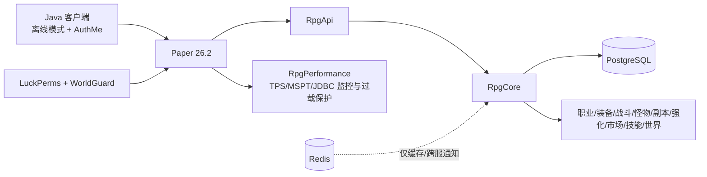

# 技术架构

## 决策

首发选择 **Paper 26.2 + Java 25**，不是 Folia、Fabric 或 Minestom。

- Paper 对原版行为、Bukkit/Paper 插件和运维工具兼容最好，适合先验证原创玩法。
- Folia 的区域线程模型要求所有实体、区域和全局任务严格选择调度器。市场事务、跨区域队伍、副本生命周期尚未稳定前直接采用，会显著扩大并发错误面。
- Minestom 适合从零实现自定义游戏，但原版生存世界、红石、生物和现成插件要自行补齐，不符合本项目“原版世界 + RPG”的目标。
- 代码不声明 `folia-supported`。第二阶段先引入统一调度器适配层，通过并发审计后再决定是否支持 Folia。

## 运行拓扑

Redis 永远不保存唯一真相。角色、货币、装备、市场和订单都以 PostgreSQL 为准。

## 插件边界

| 目录 | 所有权 | 当前状态 |
|---|---|---|
| `rpg-api` | 稳定模型、服务接口、纯规则 | 已实现并有单元测试；含主线程装备进度桥 |
| `rpg-core` | 档案、等级、体力、金币/功勋/星辉账本、财富兑换、语言服务、数据库迁移 | MVP 已实现 |
| `rpg-classes` | 职业选择、五维、转生/分支 | 选择、加点、转生、18 条阶段分支与图形菜单已实现 |
| `rpg-items` | 唯一装备、原版胚材锻造、绑定/解绑、槽揭示、原版锻造台兼容 | 胚材 0-4 级与签名 schema 4 已实现；锻纹来源/倾向纳入签名，兼容读取 schema 1/2/3 |
| `rpg-combat` | 伤害总线、职业/装备结算、处决、PvP/Boss 缩放 | 统一结算 MVP 已实现 |
| `rpg-mobs` | 动态等级、普通怪特性、精英词缀、自定义掉落 | 生命/攻击/护甲封顶缩放；九类普通怪预警能力和四类精英词缀共用有界视觉降级，伤害与掉落仍只有一套真相 |
| `rpg-dungeons` | 体力、实例、队伍、波次、Boss、隐藏门票 | 1-4 人共享 session、资格/退款回滚、预热池、排队、程序化分 tick 建图、波次、回收与恢复已实现 |
| `rpg-enhancement` | 精炼、上限强化、技能变异 | 三类命令与保护/幸运消耗已实现 |
| `rpg-market` | 托管市场、绑定边界、费用、限流 | 自制装备单件与原版物资整组托管、数据库分页、原生输入/确认、168 小时过期返还和持久化物品邮箱已实现 |
| `rpg-skills` | 技能树、技能书、分支技能、装备借用技能 | 42 个技能、六系装备借用/精通、四槽装配、分页 GUI、持久化学习/变异与双类技能书已实现 |
| `rpg-sulfur` | 26.2 硫磺方块生物调谐、剪取额度、锻纹签名 | 使用专用 Paper 事件；账号绑定锻纹通过 API 服务交给装备锻造 |
| `rpg-world` | 血月、连猎、野外稀有事件 | MVP 已实现 |
| `rpg-economy` | 原版活动装备经验、共鸣精华、狩猎/副本奖励、材料委托、功勋商店、双周商人 | 七类委托、精华日上限、区块级放置矿溯源、活动额度和周期买卖限额已实现 |
| `rpg-commerce` | 会员、累计金额、外部订单账本、累计奖励 | 星辉购买时长、跨分片周额度、会员金币补给与持久化奖励邮箱已实现 |
| `rpg-admin` | 审计管理、补偿、诊断 | XP/体力审计命令、经济分布/产销/市场库存龄快照与网站导出已实现 |
| `rpg-guide` | 主菜单、帮助查询、冒险手册、新手目标、共享旅程状态 API | 8 个真实状态目标已实现并供剧情读取；跨 Paper 前须迁移 PDC 完成位 |
| `rpg-hub` | 独立安全主城、功能 NPC、公共地标与拓荒动线 | 程序化幂等建图、11 名原生 Mannequin NPC、WorldGuard/squaremap 接入已实现 |
| `rpg-story` | 系统驱动轻主线、Citizens 私有演员、BetonQuest 白名单桥与一次性剧情奖励 | 序章、中英文状态分支、真实旅程下一步、12 并发上限、负载暂停和幂等奖励恢复已实现 |
| `rpg-community` | 社群身份、邀请、师徒契约、周建设和跨分片排行 | PostgreSQL/H2 持久化、容量与周额度行锁、幂等建设和真实成长验证已实现 |
| `rpg-ai-npc` | 只读智能问答、本地知识降级、会话限流与熔断 | OpenAI-compatible Responses/Chat 接口、2 并发有界队列和中英文回退已实现 |
| `rpg-integrations` | PlaceholderAPI 非阻塞快照、LuckPerms 动态权限上下文 | 11 个 `%sivita_*%` 占位符；职业、分支、转数上下文 |
| `rpg-performance` | TPS/MSPT、实体、区块、堆与 JDBC 指标，过载迟滞和可逆降级 | 已实现 `/rpgperf`、状态文件和管理后台接入 |

依赖方向固定为 `玩法插件 -> RpgApi/RpgCore`。玩法插件之间仅在确有加载顺序要求时写 `depend`，禁止直接访问其他插件内部类。

## 数据与事务

1. 金币不是物品，所有变动写双向账本并带 `idempotency_key`。
2. 市场上架先把物品移入服务端托管记录，购买在一个数据库事务中锁定挂牌、扣款、收手续费、给卖家入账并标记成交。
3. 物品 payload 必须带 schema 版本、唯一 `item_id`、所有者/绑定状态和服务端签名。schema 2 覆盖物品材质、揭示进度、精炼槽和突破等级；schema 3 把可交易解锁状态纳入签名；schema 4 再覆盖硫灵锻纹唯一 ID、来源、目标属性和强度。反序列化失败的物品进入隔离流程，不直接丢弃。
4. 商业累计奖励的领取标记和待发物邮箱记录在同一事务中创建；断线后继续由 `/market claim` 恢复。
5. 技能学习、点数成本和变异状态存入 `rpg_skills`；施放冷却只保留在单服内存，跨服前需要共享冷却或明确切服重置规则。
6. 活动奖励按类型记录每日金币/功勋额度；奖励、余额和来源流水在同一事务提交。
7. 功勋或星辉补给所的扣款与邮箱投递在同一事务提交，绑定物品记录玩家 UUID 和来源。
8. 金币、功勋和星辉兑换必须在同一事务中锁定三张账户表；兑换流水、日额度和周额度随余额一起提交，任何一步失败都会整体回滚。
9. JDBC 使用与 Hikari 连接池等宽的固定后台线程和有界队列；队列饱和返回可处理的失败 Future，禁止 `CallerRunsPolicy` 或任何主线程降级执行。多个 PostgreSQL-backed Paper 节点启动时先在迁移事务内取得同一把 advisory lock，30 秒未取得就失败关闭并等待编排重试，禁止并发执行 `CREATE/ALTER/INDEX`。
10. PlaceholderAPI 回调只能读取内存快照，禁止即时数据库查询；LuckPerms 存储操作只能走其异步 API。
11. 同一角色的档案变更使用 `SELECT ... FOR UPDATE` 串行化；缓存只在事务提交后的 future 阶段更新，退出后延迟淘汰。
12. 高频狩猎奖励在数据库边界按玩家批处理；每个怪物的幂等键与审计行仍保留，不能为了吞吐把多次击杀压成不可审计的一笔铸币。
13. 组队副本的每名成员分别校验并顺序创建数据库体力预留，任何成员失败会按预留号幂等返还已扣成员；门票只在全员传送成功后核销。传送成功后预留标记为 `COMMITTED`，启动时所有遗留 `RESERVED` 会自动退款，因此硬崩不会留下无法追踪的体力扣款。普通与隐藏首领奖励先以 `Boss UUID + 玩家 UUID` 写入本地 fsync 待结算日志，再由一个数据库事务同时提交成长经验、隐藏门票保底、运行回执以及核心/门票/技能书的持久邮箱投递；并发回调、硬崩重启和日志重放只命中同一回执。物品不再直接塞背包或掉到地上，玩家用 `/market claim` 领取，满背包不会吞掉奖励。每周共鸣远征荣誉继续按独立实例 `runId` 与玩家周领取键原子结算。
14. 原版活动只通过 `EquipmentProgressService` 调用装备插件公开接口；接口要求 Paper 主线程、有效 HMAC 签名和绑定者匹配，经济插件不读取或改写装备经验标签。
15. 原版不会记录普通方块来源，因此玩家放置的共鸣矿坐标写入所在区块 PDC；挖掘、活塞移动与爆炸都同步维护该集合。这个热路径没有 JDBC 查询，且标记随区块跨重启保存。
16. BetonQuest 只保存章节标签和分支对白状态；`RpgStory` 只能通过白名单动作调用真实服务。剧情奖励必须进入 `RpgCore` 账本并使用 `story:<quest>:<player>` 幂等键，禁止 YAML 直接执行发钱、发物或管理员命令。
17. 全服赛季章节只有 `RpgCore ChapterService` 一个事实源。状态保存在 `rpg_chapter_state`，历史进入 `rpg_chapter_history`；只允许带原因地推进紧邻下一章，禁止自动按日期开放、跳章和回退。职业晋升、档案和菜单读取同一缓存，跨 Paper 分片每 30 秒刷新。
18. 官网不直连 RPG 数据库。`RpgAdmin` 原子签出带 schema、修订号和采样时间的 `chapter.json`，网站只接受两分钟内且“章节顺序=最高开放转数”的完整快照；公共首页和唯一管理员后台由同一只读快照显示状态。
17. 委托和黑心商人回收在移除玩家物品前先把 `PREPARED` 托管凭据写入玩家 PDC 并立即保存；移除后改为 `ESCROWED`，数据库模糊提交只用原幂等键恢复。物品状态不完整时进入 `QUARANTINED`，绝不自动发币或双倍返还。
18. 资源委托的主动劳作证明不放在 PDC：`rpg_commission_evidence_daily/sources/claims` 是唯一权威状态。所有节点先锁定账号日期行，再更新来源额度、总额度和提交次数；释放仅写墓碑。玩家存档回档、跨分片并发和相同凭据重放均不能恢复额度或重复认领。
18. 自制装备挂牌把签名 `item_id` 写入 `open_item_identity` 唯一索引；同一装备只能存在一笔 `PREPARED/ACTIVE` 托管，成交、取消或隔离后释放，买家以后仍可正常解绑再挂牌。
19. 星辉战力辅助品的每周额度在锁定 `rpg_commerce_accounts` 后统计和写入，同一玩家的跨分片并发购买被数据库串行化；GUI 额度不是安全边界。
20. 星辉会员购买不生成伪邮箱件；星辉扣除、周额度和 `member_until` 延长在一个事务中提交。会员补给按“金币账户 -> 商业账户”的统一锁顺序判定折扣，金币销毁、日限、审计流水和普通原版物品邮箱交付一起提交，避免与财富兑换死锁。
21. 市场公开页只做带上限的数据库分页；过期扫描每批最多 100 条，并用 `ACTIVE -> EXPIRED` 条件转换保证多分片只返还一次。经济快照统计挂牌 P50/P90/最老库存龄和 7 日成交/过期量，但不会自动调价。
22. 每周共鸣远征使用 `SeasonExpeditionService` 作为唯一记录边界。轮换行锁串行化全服首通；`runId` 防结算重放，`season + rotation + player` 防周奖励重领。赛季荣誉没有财富兑换或战力消费者，重复竞速不会铸造金币、功勋、星辉或物品。

副本返回点保存在玩家 PDC 并立即 `saveData`，可以在重登和死亡时恢复；体力预留保存在 `rpg_dungeon_energy_reservations`。静态测试已覆盖预留重放、提交、重复退款和启动恢复，真实 Paper 验收仍需注入排队、传送和世界卸载时的硬崩场景。

## 可观测性与恢复

- 每次货币、市场和管理员补偿写结构化审计事件。
- `RpgAdmin` 每 5 分钟原子导出只读经济快照；网站校验 schema 和 20 分钟新鲜度后显示，不从浏览器直连数据库。
- 每日全量 PostgreSQL 备份、每 15 分钟 WAL 归档；世界文件每日快照。
- 每次更新先复制生产数据到预发布服，跑迁移、登录、锻造、市场购买和副本返回测试。
- 目标不是“从未报错”，而是任何失败都不会复制装备、重复扣款或把玩家困在副本。
