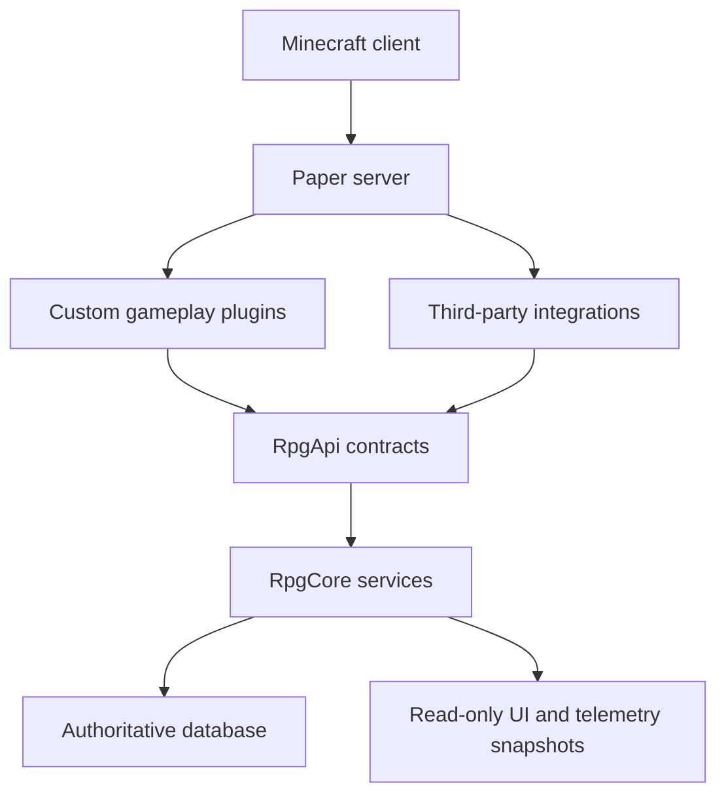

# Architecture

[English documentation](README.md) · [Constitution](GAME_ECONOMY_CONSTITUTION.md) · [Operations](OPERATIONS.md)

SivitaHub is a multi-project Java build for a Paper server. Shared contracts live in `RpgApi`; authoritative persistent services live in `RpgCore`; feature plugins compose those services with the game world. The checked-in target is Paper 26.2 and Java 25. This repository does not declare Folia support.

## The ownership model

The diagram describes service ownership, not every plugin's Gradle or load-order dependency. The actual runtime edges are declared in each module's `plugin.yml`. Gameplay plugins should call published services, not another plugin's private implementation or a second copy of its state.

H2 is the development default. PostgreSQL is the intended production authority. Caches and exported snapshots support presentation and reads; they do not authorize a monetary change or replace transaction-time checks.

Sources: [module settings](../../settings.gradle.kts), [build configuration](../../build.gradle.kts), [database implementation](../../plugins/rpg-core/src/main/java/cn/originalrpg/core/persistence/Database.java), and the [detailed Chinese architecture](../ARCHITECTURE.md).

## All 25 plugin modules

| Module | Responsibility |
|---|---|
| `rpg-api` | Shared models, service contracts, and deterministic rules; also a runtime plugin |
| `rpg-core` | Profiles, progression, currencies, persistence, language service, chapter state, and recovery services |
| `rpg-classes` | Class selection, attributes, branches, ascension, and hidden-path interaction |
| `rpg-items` | Forging, signed item identity, binding, equipment development, and retirement paths |
| `rpg-combat` | Shared damage and combat rules |
| `rpg-mobs` | Adaptive monsters, overworld behaviors, elite affixes, and reward integration |
| `rpg-dungeons` | Shared instances, parties, reservations, waves, bosses, and reward recovery |
| `rpg-enhancement` | Refinement, limit breaks, and skill mutation |
| `rpg-market` | Escrow listings, market interactions, fees, delivery, and stall views |
| `rpg-skills` | Skill catalog, learning, loadouts, casting, and equipment-based skill access |
| `rpg-sulfur` | Sulfur resonance, extraction, and signed forging imprints |
| `rpg-world` | World events, Blood Moons, and hunt chains |
| `rpg-economy` | Survival activity integration, commissions, reward limits, and economy shops |
| `rpg-commerce` | Audited commercial account operations, catalogs, memberships, and reward delivery |
| `rpg-admin` | Audited administration, diagnostics, incident handling, and snapshot exports |
| `rpg-guide` | Main menu, help, onboarding, Quest Center, and shared journey state |
| `rpg-hub` | Protected hub, service NPCs, travel, bed homes, and wayfinding |
| `rpg-integrations` | PlaceholderAPI, permissions contexts, HUD integration, and read snapshots |
| `rpg-performance` | Runtime telemetry, load state, and bounded visual degradation |
| `rpg-cosmetics` | Auras, flight trails, and shared cosmetic effects |
| `rpg-ai-npc` | Read-only AI guidance with bounded requests and local fallback |
| `rpg-story` | Optional story flow, actors, escort sessions, and authoritative rewards |
| `rpg-community` | Communities, membership, mentorship, projects, and governance interfaces |
| `rpg-essentials` | EssentialsX utilities constrained by RPG command and travel boundaries |
| `rpg-pets` | MyPet-backed companions, progression, appearances, and combat restrictions |

The database migration tool is an additional Gradle project; it is not a 26th gameplay plugin.

## Progression is one model

[`ProgressionRules`](../../plugins/rpg-api/src/main/java/cn/originalrpg/api/rules/ProgressionRules.java) defines local levels 1–30, ascensions 0–3, and effective levels 1–120. [`PlayerProfile`](../../plugins/rpg-api/src/main/java/cn/originalrpg/api/model/PlayerProfile.java) delegates to that model. Displays, encounter requirements, and progression services must distinguish these values explicitly.

The source uses stage XP budgets with normalized local-level weights. Skill-point milestones use player, ascension, and local milestone identity so a repeated grant cannot become a new reward merely by changing the surrounding receipt. Ascension is owned by the dedicated service and must recheck its requirements inside the transaction.

Some older audit documents describe earlier implementations. Use the current source and a dated audit together; do not reintroduce a retired model because a historical paragraph still mentions it.

## Money, items, and delivery

The [constitution](GAME_ECONOMY_CONSTITUTION.md) defines the required invariants:

- Balance changes and their audit/idempotency records commit together in the core ledger.
- A player trade redistributes existing wealth, with fees removed according to policy.
- The market has a single escrow settlement model. A physical stall is a view into it, not another inventory or balance ledger.
- Signed item identity, ownership, binding, and lifecycle state participate in eligibility checks.
- A refund references the original debit and cannot be replayed as unrelated compensation.
- A delivered item and a monetary balance are different concerns; durable delivery lets a committed reward survive a disconnect or full inventory.

Dungeon entry reserves Energy persistently. Reward recovery has its own durable receipt/journal path and sends items through the mailbox. These mechanisms reduce ambiguity around crashes, but their presence is not proof that every Paper lifecycle race has been exercised. Review real crash and replay tests before a release.

Start source review in [`rpg-core/persistence`](../../plugins/rpg-core/src/main/java/cn/originalrpg/core/persistence), [`rpg-market`](../../plugins/rpg-market/src/main/java/cn/originalrpg/market), and [`rpg-dungeons`](../../plugins/rpg-dungeons/src/main/java/cn/originalrpg/dungeons).

## Threading and load boundaries

The ordinary core persistence paths dispatch JDBC work through a bounded executor. The core defaults use six worker threads, a queue capacity of 256, and a six-connection pool. Saturation must fail explicitly rather than run the database work on the server tick thread. Bukkit world, entity, and inventory operations must return to the appropriate server execution context.

That threading rule is not yet universally satisfied by incomplete integrations: the disabled-by-default `SessionLeaseListener` directly reads JDBC in its join handler. [Current source review IR-03](../audits/CURRENT_SOURCE_REVIEW.md) records that issue as a multi-node enablement blocker.

Placeholder callbacks should read snapshots rather than query the database synchronously. AI requests have bounded concurrency, a timeout, and a circuit-breaker/local-fallback path. Visual plugins consume shared load information and reduce rendering work; that mechanism does not replace a measured capacity plan.

Sources: [database settings](../../plugins/rpg-core/src/main/resources/config.yml), [AI settings](../../plugins/rpg-ai-npc/src/main/resources/config.yml), and [performance design](../PERFORMANCE.md).

## Internationalization

[`MessageService`](../../plugins/rpg-api/src/main/java/cn/originalrpg/api/service/MessageService.java) is the shared message contract. [`YamlMessageService`](../../plugins/rpg-core/src/main/java/cn/originalrpg/core/i18n/YamlMessageService.java) loads `zh_cn` and `en_us`, selects the configured default or player's saved preference, and applies named placeholders. The hub has its own locale bundles, while several other modules keep bilingual content in configuration or knowledge data.

Changing a display string must preserve placeholder names, command IDs, and the actual operation's semantics. Translation-key parity does not prove that a menu fits, an entity name is localized, or a third-party dialog follows the same locale. Those require runtime and client inspection.

## Deployment boundaries and incomplete capabilities

Some sources refer to a larger private deployment tree, website, and server configuration. Those components are outside this repository. `plugin.yml` and the [runtime lock](../../scripts/runtime-smoke-plugins.lock.json) are useful integration evidence, but they do not assemble that deployment on their own.

Similarly, the economy simulator is not yet a completed behavioral model, and the presence of Session Lease or Outbox classes does not establish a complete multi-node protocol. The default configuration leaves session admission, cross-node outbox, advanced governance, and season-attunement behavior off. Each must be assessed as an integration, including its producer, consumer, authority, failure mode, and operating evidence. See the [roadmap](ROADMAP.md).
