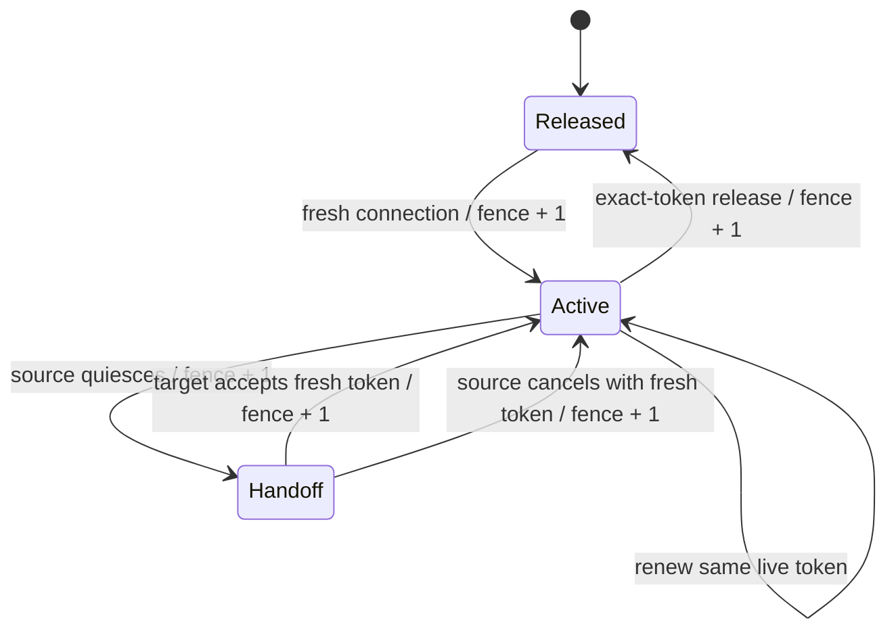

# Player session authority and transactional events

This is a developer guide to the executable core mechanisms. They are opt-in persistence features; they do not enable a complete Velocity network. The default standalone deployment retains `session-lease.enabled: false`, `outbox.enabled: false`, and `outbox.dispatch.enabled: false`.

## Authority, identity and execution

`PlayerSessionService` owns one connection per player UUID in `rpg_session_leases`. A lease includes the stable node ID, that Paper process's random token, an independent connection token, a monotonically increasing fence, and an expiry. Reconnecting on the same process must receive a new connection token. Reusing an expired or released token never restores authority.

`JdbcSessionLease` checks the current node-process lease and the player lease in the database. PostgreSQL checks use `clock_timestamp()` after obtaining row locks; `CURRENT_TIMESTAMP` would incorrectly retain the transaction's start time during a lock wait. Public expiry values are truncated to the schema's microsecond precision before they are persisted and returned, so an identical replay returns the same value.

The Paper adapter acquires the connection lease in `AsyncPlayerPreLoginEvent`, with a bounded wait on that asynchronous login thread. Admission errors reject the login. Main-thread login/join/authentication events only consult local state. The authenticated-ready event enables player-authorized calls; AuthMe logout immediately removes that local admission while retaining the connection lease until Paper unloads the player. This prevents an unauthenticated but still-loaded `player.dat` from being admitted on another backend. Renewal runs off the main thread. Lost authority revokes the connection and schedules a main-thread kick. Quit and plugin disable release the exact connection conditionally, so an old quit cannot release a newer connection.

Acquisition, renewal and handoff transactions recheck node ownership and expiry before committing. Release is deliberately different: an old process may revoke its own matching row even after losing its node lease. It cannot create authority or alter a replacement token.

## Protect the actor, preserve background recipients

Public core services declare the player authorizing an action using `@SessionActor`. The zero-based `argument` identifies a UUID parameter; `member = "playerId"` identifies a public accessor on an immutable request. The annotation is on the API interface, including default overloads.

`RpgCorePlugin.registerService` installs `SessionGuardedService` facades when session authority is enabled. The facade captures the original immutable actor token before the implementation queues JDBC work. Missing local admission fails closed. `AsyncJdbc` copies that scope explicitly into its submitted operation and restores/removes it in `finally`. Ordinary threads and unrelated tasks do not inherit a previous player's token.

`SessionFencedDataSource` verifies that captured authority in the **same connection and transaction** as the business mutation. It locks the node and player session before business rows and checks expiry again before commit. A queued request from an old connection therefore cannot borrow the new token obtained by a subsequent login. A transaction that runs beyond its lease rolls back, even if its locks prevented takeover while it ran.

The lock order is node → player session → business rows. PostgreSQL read-only node ownership checks use `FOR SHARE`, including `JdbcNodeLease.requireOwned`, so a dungeon reservation does not attempt a conflicting SHARE-to-UPDATE lock upgrade. Lease acquisition/replacement, heartbeats and recovery still use the appropriate exclusive locks.

### Declared player actions

| Boundary | Fenced actor actions |
|---|---|
| Profiles | Choose class, allocate attributes, prepare starter build, spend Energy, use an Energy quota, redeem a skill book |
| Skills / classes | Learn and upgrade, set/clear/mutate a variant, choose a branch, ascend, activate a hidden path |
| Economy | Explicit Gold burn, Gold transfer sender, activity-store purchase, wealth exchange, merchant purchase/buyback, commission evidence claim |
| Commerce | Earned-credit purchases, membership/supply purchases, reward claim, Support Credit spend |
| Market | Listing preparation/activation/cancellation, purchase, mailbox acknowledgement, buy/crafting order placement/fill/cancellation; the interfaces declare each actor explicitly |
| Community | Create, invite, join, leave, kick, transfer, bind a mentor, contribute, claim a project reward, submit/approve/deny governance actions and assign roles; lifecycle actions use the same declaration |
| Other | Pet revival begin, dungeon entry reserve, player-initiated season-merit deposit/withdrawal |

Credits/refunds, accepted XP grants, natural-mob and dungeon reward replay, mailbox enqueue, mentor verification, seasonal settlement, evidence grant/release and durable recovery are recipient-oriented server work. They do not acquire the recipient's player lease. A player being offline must not prevent an already-earned reward, refund or settlement from completing.

This distinction is a trusted server API contract, not a sandbox against a malicious plugin with direct database access. Plugin authors must not bypass the registered facade for new player actions. `EquipmentOperationService.settle` intentionally remains a durable escrow/replay boundary because it accepts a persisted operation, including recovery; complete multi-node inventory acceptance still needs a separate original-actor admission/transport protocol.

### Delayed application code

For a call made immediately from an authenticated command handler, the registered service captures the current actor automatically. If application code delays the *invocation* itself, retain the original lease before scheduling that work:

```java
PlayerSessionLease original = sessions.current(playerId)
        .orElseThrow(() -> new IllegalStateException("Player is not admitted"));

return preparation.thenCompose(prepared -> sessions.fenced(original,
        () -> guardedService.performPlayerAction(playerId, prepared)));
```

`performPlayerAction` is an illustrative service method. Use the actual service API and its normal ownership/idempotency checks. Do not call `sessions.current` again inside the delayed callback: that could select a replacement connection. The supplier must invoke the service now; returning lazy work to run after the scope closes does not preserve authority. Future continuations outside the submitted SQL operation are ordinary application code and must explicitly retain the original token when they initiate another protected operation.

`PlayerSessionService` is registered only when its feature is enabled. Integrations supporting the unchanged standalone mode should use their normal service call when the session service is absent; an enabled service with a missing actor token must fail rather than falling back.

## Handoff state machine

A handoff moves authority, never items or player state:



`prepareHandoff` removes local write admission before publishing the reservation. Normal acquisition cannot steal an unexpired handoff. Only the named target can accept its ticket; retrying acceptance with the same new connection token returns the same authority. Cancellation is restricted to the source process and also requires a fresh connection token. An old source release or renewal cannot affect the accepted target.

There is no Velocity forwarding/player-state adapter in this change. A future adapter must quiesce the source, save and verify player/inventory state, carry the handoff ticket over an authenticated path, restore the target exactly once, and coordinate its login admission with the core connection lifecycle. Calling this API alone is not a safe cross-server teleport.

## Transactional dungeon events

A dungeon settlement writes the authoritative XP/item delivery/reward receipt and its outbox row in the same transaction. The event key includes **run ID and player UUID**. A party sharing one run therefore produces one completion event per player. An identical publication is an idempotent replay; reusing a key with a different type, aggregate or payload aborts the business transaction. Publication with auto-commit enabled is rejected.

`OutboxDispatcher` runs in the background and claims a bounded batch using `FOR UPDATE SKIP LOCKED`. Each claim has a random token and deadline. A dead worker's claim becomes eligible again after its deadline. A stale token cannot process or acknowledge a replacement claim. Failed and deferred events receive a persisted exponential retry delay, capped at five minutes; an unknown event type remains visible and cannot occupy every first-page attempt while eligible healthy events wait.

The built-in `JdbcDungeonCompletionInbox` is a real consumer. It validates the event's run/player/dungeon against `rpg_dungeon_reward_receipts` and writes a unique `(run_id, player_uuid)` notification projection. Its insert and the outbox `processed_at` marker commit together. A handler exception, deferral or expired claim rolls back provisional SQL effects. This consumer creates no reward, currency or item.

`DungeonCompletionNotificationListener` reads that inbox asynchronously for authenticated connections. The main thread refreshes the local profile projection and sends the existing mailbox hint; acknowledgement returns to the SQL executor. Disconnect/logout/replaced-session callbacks do not send or acknowledge old work. Offline notifications remain available after reconnect. Chat is at-least-once: a crash after sending but before acknowledgement may repeat the hint. It cannot repeat the reward. Other external-effect handlers must deduplicate by event ID themselves; the database cannot atomically commit an arbitrary HTTP response or chat message.

## Evidence and remaining gates

The production schema is exercised by `JdbcPlayerSessionLifecycleTest`, `SessionWriteFencingTest`, `TransactionalOutboxTest` and `DungeonRewardOutboxWiringTest`. Their network fixture uses H2 by default; setting the dedicated `SIVITA_NETWORK_TEST_POSTGRES_URL`, `_USER`, and `_PASSWORD` runs the same cases in an isolated PostgreSQL schema. `PostgresSessionLockOrderTest` is skipped without that PostgreSQL environment because H2 does not establish PostgreSQL shared-lock behavior. Execution results belong to the corresponding build/CI report.

These are database/service behavior tests. They do not establish a two-Paper `kill -9` handoff, client acceptance, capacity, mailbox inventory transfer or production rollback rehearsal. Full network enablement still requires identity migration, AuthMe/LuckPerms coordination, signed inventory/PDC transport, complete mailbox/playerdata transport, cooldown/combat/world ownership rules and distributed failure tests. Keep these gates explicit.

For schema rollout and operational queries, see [session/outbox migration](../operations/SESSION_OUTBOX_MIGRATION.md). PostgreSQL documents the queue use of [SKIP LOCKED](https://www.postgresql.org/docs/18/sql-select.html), [shared versus exclusive row locks](https://www.postgresql.org/docs/18/explicit-locking.html), and the distinction between [transaction-start and wall-clock timestamps](https://www.postgresql.org/docs/18/functions-datetime.html).

## Offline identity maintenance

The separate [offline UUID migration tool](../operations/UUID_IDENTITY_MIGRATION.md) provides a reviewed Core database-only transformation and atomic operational receipt. It requires stopped nodes and blocks opaque/external identity state without an adapter. Session leases do not establish account ownership or migrate physical inventories.

## Separate mailbox admission protocol

The [durable mailbox claim protocol](../operations/MAILBOX_CLAIM_MIGRATION.md) now owns per-delivery reservation and physical-admission tokens in the existing delivery row. `CLAIMED` can expire before authorization; `STAGING` can never be reissued on timeout. The Paper adapter saves a unique delivery/token receipt and clears both markers only after durable acknowledgement. Session fencing remains the actor boundary, not a substitute for this protocol. Actual cross-node playerdata transport and crash acceptance remain deployment gates.
