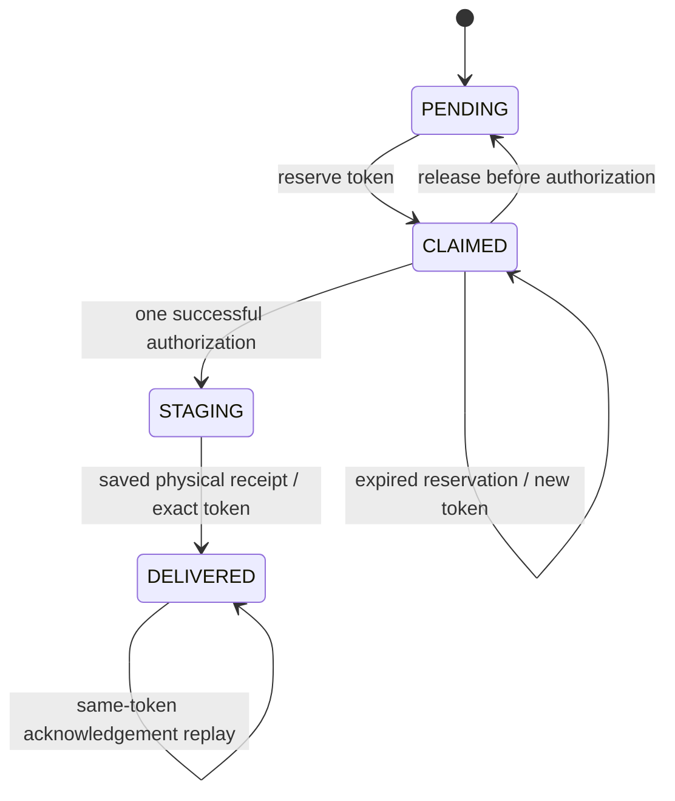

# Durable mailbox claims

The mailbox claim protocol extends each existing `rpg_market_deliveries` row. It provides cross-node reservation and one-time permission to stage a physical item. It creates no new market, asset ledger or currency. Player-session fencing and mailbox claims serve separate purposes: the session identifies who may initiate an action, while the delivery row owns whether that particular item may be admitted to an inventory.

The complete source path is `MarketService` → `JdbcMarketService` / `MailboxDeliveryLedger` → `MailboxDeliveryCoordinator` → the `MarketCommand` Paper inventory adapter. `MailboxClaimGate` is only a process-local command throttle.

## State and authority



| State | Permitted behavior |
| --- | --- |
| `PENDING` | A valid actor may reserve the existing payload. No physical item is authorized yet. |
| `CLAIMED` | One token owns the reservation for 30 seconds. A live repeat by the same original authority returns the same claim. A different token cannot take it until it expires. The same expired token is not revived. |
| `STAGING` | The database has authorized one physical admission. Expiry, disconnect or process death never returns this state to `PENDING`. The item may already exist even when the caller did not receive the response. |
| `DELIVERED` | The same saved physical receipt can reconfirm its committed acknowledgement. A different token or owner is rejected. |
| `QUARANTINED` | All claim, authorization, release and acknowledgement paths reject it. The original payload and audit facts remain available for review. |

Legacy `commerce-reward:%` sources are rejected at every protocol entry regardless of the current state. A non-null quarantine reason also prevents token operations. The Phase 5 paid-material isolation is not bypassed by claiming or replaying a receipt.

## Database changes

The migration adds these nullable columns to the existing row:

| Column | Meaning |
| --- | --- |
| `claim_token` | Random operation token, globally unique while retained on a delivery row |
| `claim_expires_at` | Reservation deadline; authorizing after this deadline is refused |
| `claim_started_at` | When the database granted physical admission |
| `claim_node_id` | Original actor's node, when player-session authority is enabled |
| `claim_process_token` | Original Paper-process identity |
| `claim_session_token` | Original player connection identity |
| `claim_fence` | Original monotonic session fence |

`uq_rpg_market_delivery_claim` enforces the unique token. The normal `CREATE TABLE` definition and all seven additive `ALTER ... ADD COLUMN IF NOT EXISTS` statements agree. Existing deliveries remain in their existing states with null claim metadata; no old physical outcome is inferred by the migration.

In single-node mode with player-session authority disabled, the original-actor fields remain null. The delivery token/state protocol still runs. Enabling network authority adds the real actor/session fence; it does not silently turn off the mailbox protocol in the default configuration.

## Physical admission and recovery

1. The command lists bounded candidate rows. A list snapshot is not permission to create an item.
2. `claimDelivery` locks the authoritative delivery row, checks recipient/source/quarantine, and reserves its current payload. The command never renders a stale UI payload.
3. The Paper adapter validates the payload, capacity and stack size. It clears only the obsolete operation/listing marker at this trusted deserialization boundary, then adds both `rpgmarket:delivery_id` and `rpgmarket:delivery_claim_token` to the prepared item. No inventory mutation occurs at preparation.
4. `authorizeDelivery` changes `CLAIMED` to `STAGING` only for the exact live token and original session. Only the single `AUTHORIZED` response permits this callback to insert the item. A repeat returns `INDETERMINATE`.
5. The main-thread adapter rechecks the exact authenticated player, writes one validated stack to one empty inventory slot and saves player data. Using a single slot avoids partial insertion or accidentally splitting one receipt into multiple marked stacks.
6. `acknowledgeDelivery` confirms the same player/token and atomically records `DELIVERED`. Only a successful durable acknowledgement permits the Paper adapter to remove both PDC markers and save again.

A reconnect scans the complete inventory and cursor. A unique saved token receipt may acknowledge the old `STAGING` or `DELIVERED` row under the new current player session. The original session remains in the row for audit. Recovery re-saves the existing receipt before SQL acknowledgement, so an earlier `saveData()` exception cannot be bypassed by immediately acknowledging a still-volatile item.

Malformed delivery IDs, malformed/orphan tokens, duplicate delivery IDs and a token copied onto multiple items stay frozen. They are not silently repaired or treated as new deliveries. The item-presentation layer also skips an item carrying either mailbox marker, including an orphan claim-token marker.

An existing delivery-ID-only item follows the legacy acknowledgement path. That API is allowed only when `claim_token IS NULL`; it cannot acknowledge a new token claim. An old binary must not run concurrently with the new protocol, because it does not understand `CLAIMED`/`STAGING` or the second PDC marker.

## Failure outcomes

| Failure boundary | Result |
| --- | --- |
| Inventory full or invalid payload before authorization | Release only the `CLAIMED` reservation, retaining the original pending delivery. |
| Claim reply lost | Retry the same live token; no physical stage has been authorized. An expired unstarted claim can later be reserved with a fresh token. |
| Authorization committed but reply lost | Remain `STAGING`; no retry receives another `AUTHORIZED`. Existing physical proof can recover it. Absence of proof requires reconciliation. |
| Disconnect/unload before the authorized callback | The old callback cannot insert an item. If already `STAGING`, the database still retains the uncertain outcome. |
| Physical insertion or save fails | Retain the token row and any physical marker. Do not issue another item or undo `STAGING`. |
| Acknowledgement committed but reply lost | Keep the item frozen until the same token reconfirms `DELIVERED`; no second insertion. |
| Successful acknowledgement but marker cleanup/save interrupted | The same physical receipt can reconfirm and clear both markers after reconnect. |
| Old actor or wrong token attempts release/ack | Refuse the operation. A stale actor is also fenced by the original SQL session context. |
| Expired `STAGING` with no visible item | Keep it unresolved. A lease timeout cannot prove that an item was never saved on another node. |

One unresolved row does not prevent unrelated pending rewards from being collected. Candidate reads prioritize `PENDING` rows, and a blocked row is retained while the command continues through its bounded batch.

## Inspection and maintenance

Stop all relevant writers before a deployment or identity migration. Inspect unresolved claims without modifying them:

```sql
SELECT id, player_uuid, source, state, claim_token, claim_expires_at,
       claim_started_at, claim_node_id, claim_session_token, claim_fence,
       quarantine_reason
FROM rpg_market_deliveries
WHERE state IN ('CLAIMED', 'STAGING', 'QUARANTINED')
ORDER BY created_at;
```

The [UUID migration tool](UUID_IDENTITY_MIGRATION.md) blocks every `CLAIMED` or `STAGING` row, including expired claims and empty/invalid payloads. Its separate opaque-payload checks remain active. Resolve through the original authority and physical evidence; do not clear claims or delete item payloads to make a migration preview pass.

There is deliberately no automatic “reset uncertain delivery” command. Staff reconciliation must establish the actual saved inventories and pending markers across every involved node. A future deployment-specific playerdata adapter must preserve the item ID, claim token and admission outcome together. Merely changing the database state to `PENDING` could duplicate an item.

## Upgrade and rollback

Use a stopped deployment, run the additive RpgCore migration, and deploy the API, Core and Market artifacts from the same build. Existing normal receipts can finish through the null-token compatibility path; prohibited paid receipts remain isolated. Validate a restored copy before opening admissions.

Once a `CLAIMED` or `STAGING` row or claim-token PDC exists, an older Market binary is not a safe rollback target. Keep the current recovery implementation, reconcile using saved evidence, or restore a coordinated full backup while all authorities remain stopped. Dropping claim columns or removing a PDC marker is not a rollback.

## Evidence boundary

`JdbcMailboxDeliveryClaimTest` exercises the actual migrated database: distinct claim/authorization/ack stages, token uniqueness, concurrent callers, expiry, safe release, source/quarantine refusal, lost authorization and acknowledgement responses, and replaced-session fencing. It uses the shared network fixture, so the same business tests can run against an isolated real PostgreSQL schema.

`MailboxDeliveryCoordinatorTest` uses the real JDBC implementation and the actual production callback coordinator with a controlled physical-inventory port. It checks asynchronous ordering, saved-receipt recovery, old-login callbacks, plugin unload, lost replies, capacity and refusal to thaw a denied acknowledgement. This is stronger than a separate state-machine simulation, but it is still not an actual Paper inventory/storage acceptance run. `MailboxReceiptScanTest` covers cursor, malformed and duplicate dual-marker cases. The source contract verifies the trusted metadata boundary remains wired into `MarketCommand`.

Full network enablement still requires a verified playerdata/PDC transport and handoff, coordinated authentication, actual two-Paper crash/reconnect exercises, rollback rehearsal and human acceptance. The database protocol closes its own admission/receipt boundary; it does not prove atomic external inventory storage.
